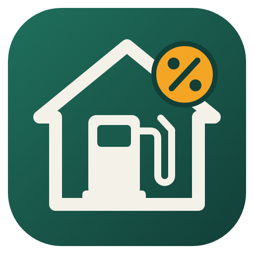

<p align="center"></p>

# MOYA Promocje – integracja Home Assistant (HACS)

[](https://hacs.xyz/)

Integracja kilka razy dziennie sprawdza stronę [moyaexpress.pl/aktualnosci](https://moyaexpress.pl/aktualnosci)
i wyciąga z najnowszego artykułu o promocji:

- czy promocja jest (nadchodzi / trwa / zakończona),
- wysokość rabatu w **gr/l**,
- dni obowiązywania (np. `06.11 – 08.11.2026 (pt, sob, nd)`),
- **kod rabatowy**,
- baner promocji jako encję obrazu do dashboardu,
- linki do regulaminu i listy stacji.

## Instalacja przez HACS

1. HACS → menu (⋮) → **Niestandardowe repozytoria**.
2. Repozytorium: `https://github.com/woojtekk/ha_moya`, kategoria: **Integracja** → Dodaj.
3. Wyszukaj **MOYA Promocje** → Pobierz.
4. Zrestartuj Home Assistant.
5. Ustawienia → Urządzenia i usługi → **Dodaj integrację** → *MOYA Promocje*.
6. Wybierz, co ile godzin sprawdzać stronę (domyślnie 4 h, czyli 6 razy na dobę).
   Można to później zmienić w opcjach integracji.

### Instalacja ręczna

Skopiuj katalog `custom_components/moya_promo` do `config/custom_components/` i zrestartuj HA.

## Encje

| Encja | Opis |
|---|---|
| `binary_sensor.moya_promocje_promocja` | `on`, gdy promocja nadchodzi lub trwa; w atrybutach komplet danych |
| `binary_sensor.moya_promocje_promocja_dzis` | `on`, gdy promocja obowiązuje dzisiaj |
| `sensor.moya_promocje_rabat` | wysokość rabatu, gr/l |
| `sensor.moya_promocje_kod_rabatowy` | kod rabatowy (atrybut `source`: `article` = z treści, `url` = z adresu artykułu) |
| `sensor.moya_promocje_dni_promocji` | dni w czytelnej formie |
| `sensor.moya_promocje_poczatek_promocji` / `..._koniec_promocji` | daty (device class `date`) |
| `sensor.moya_promocje_status_promocji` | `active` / `upcoming` / `expired` / `unknown` / `none` |
| `sensor.moya_promocje_tytul_promocji` | tytuł; atrybuty: `url`, `terms_url`, `stations_url`, `image_url` |
| `image.moya_promocje_baner_promocji` | baner promocji |
| `calendar.moya_promocje_promocje_moya` | kalendarz: każda promocja jako wydarzenie całodniowe z kodem, kwotą i linkami w opisie |

### Kalendarz

Przy każdym sprawdzeniu integracja czyta wszystkie promocje z pierwszej strony aktualności (ok. 6 ostatnich)
i zapisuje je w pamięci HA (`.storage/moya_promo.*`), więc historia w kalendarzu rośnie z czasem i przetrwa restart.
Artykuł jest pobierany tylko raz – kolejne sprawdzenia ściągają wyłącznie listę.
Kalendarz jest `on`, gdy promocja trwa; widać go też w panelu **Kalendarz** w HA.

```yaml
type: calendar
entities:
  - calendar.moya_promocje_promocje_moya
initial_view: listWeek
```

Identyfikatory encji mogą się różnić, jeśli HA ma ustawiony inny język – sprawdź je w ustawieniach urządzenia.

Status liczy się na bieżąco i przełącza o północy, bez ponownego pobierania strony.
Ręczne odświeżenie: akcja `homeassistant.update_entity` na dowolnej encji integracji.

## Przykładowy dashboard

```yaml
type: vertical-stack
cards:
  - type: conditional
    conditions:
      - condition: state
        entity: binary_sensor.moya_promocje_promocja
        state: "on"
    card:
      type: picture-entity
      entity: image.moya_promocje_baner_promocji
      show_name: false
      show_state: false
      tap_action:
        action: url
        url_path: https://moyaexpress.pl/aktualnosci
  - type: markdown
    content: >
      
      ## ⛽ MOYA: −{{ states('sensor.moya_promocje_rabat') | int(0) }} gr/l

      **Kiedy:** {{ states('sensor.moya_promocje_dni_promocji') }}  
      **Kod rabatowy:** `{{ states('sensor.moya_promocje_kod_rabatowy') }}`  
      **Status:** {{ states('sensor.moya_promocje_status_promocji') }}

      [Artykuł]({{ state_attr('sensor.moya_promocje_tytul_promocji', 'url') }}) ·
      [Lista stacji]({{ state_attr('sensor.moya_promocje_tytul_promocji', 'stations_url') }}) ·
      [Regulamin]({{ state_attr('sensor.moya_promocje_tytul_promocji', 'terms_url') }})
      
      Brak aktualnej promocji MOYA.
      
```

## Powiadomienia o nowej promocji

Integracja wysyła zdarzenie **`moya_promo_new_promotion`** dokładnie raz dla każdej nowej promocji
(także gdy pojawiła się w trakcie restartu HA). Dane są w `trigger.event.data`:
`title`, `url`, `amount`, `code`, `days`, `start`, `end`, `status`, `image_url`, `stations_url`, `terms_url`, `test`.

Test bez czekania na nową promocję: **Narzędzia deweloperskie → Akcje → `moya_promo.announce_current`**.

Gotowa automatyzacja WhatsApp (nowa promocja + przypomnienie 18 h przed końcem + test przyciskiem „Uruchom”):
**[`examples/automation_whatsapp.yaml`](examples/automation_whatsapp.yaml)**. Wklej ją w edytorze automatyzacji
(⋮ → *Edytuj w YAML*) i uzupełnij numery w `wa_to`.

Ręczne wysłanie zdarzenia z własnymi danymi: **Narzędzia deweloperskie → Zdarzenia**, typ
`moya_promo_new_promotion`, dane np.:

```yaml
title: "Rabat od MOYA - tankuj taniej 27 gr/l!"
url: "https://moyaexpress.pl/1315"
amount: 27
code: "1315"
days: "13.11 – 15.11.2026 (pt, sob, nd)"
test: true
```

## Jak to działa

1. Pobiera listę aktualności i wybiera najnowszą pozycję wyglądającą na promocję
   (słowa kluczowe: rabat, taniej, promocja, gr/l, kod).
2. Pobiera artykuł (tylko gdy pojawi się nowy – poprzedni jest trzymany w pamięci).
3. Z treści wyciąga kwotę `NN gr/l`, kod po frazie „Kod rabatowy”, zakres dat po „w dniach”,
   baner z `og:image` oraz linki PDF do regulaminu i listy stacji.
4. Jeśli kodu nie ma w tekście, używa końcówki adresu artykułu (MOYA nadaje artykułom adres równy kodowi, np. `/0608`).

Parser nie ma zależności od HA – logikę można testować samodzielnie (`custom_components/moya_promo/parser.py`).

## Uwagi

Integracja nie jest powiązana z Anwim S.A. ani MOYA. Zmiana wyglądu strony może wymagać poprawek parsera.

## Wydania

Nowe wydanie powstaje automatycznie (workflow `.github/workflows/release.yml`): wystarczy podnieść `version`
w `custom_components/moya_promo/manifest.json` i dopisać sekcję `## X.Y.Z – data` w `CHANGELOG.md`.
Workflow utworzy tag `vX.Y.Z` i wydanie z opisem z changeloga; HACS zaproponuje aktualizację.
